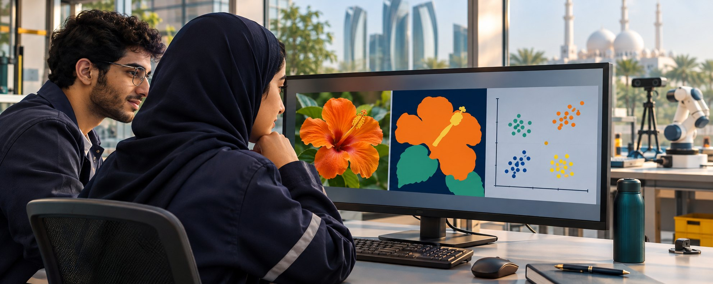

# AI Engineering Foundations and Competition Practice

Start with a photograph and a question: how much detail can a model preserve using just four colours? You’ll use K-means to find out, then explore how the task changes when you have a target to predict. You’ll forecast electricity use, classify support messages by topic and use stereo cameras to estimate an object’s height above a conveyor.

Across six weeks, 12 recorded lessons combine short readings with hands-on Python exercises. You’ll learn to choose a baseline, test a model on unseen data and explain where it fails. Optional online office hours give you time to discuss your experiments with your trainer. The course ends with an individual competition-style challenge in a new domain.

